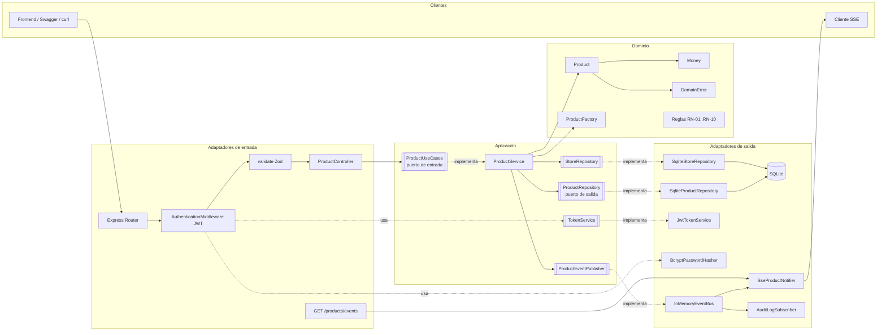
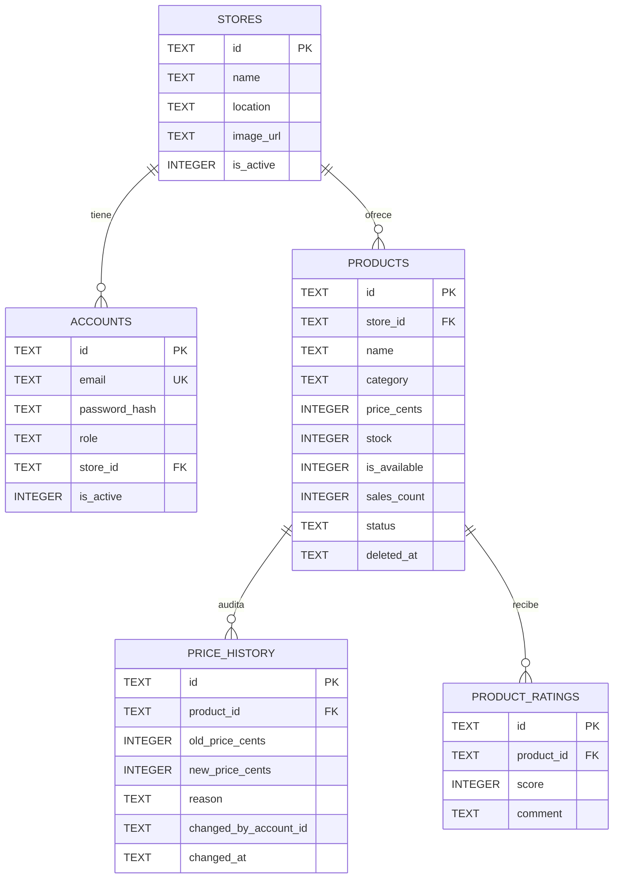

# Documento de Arquitectura — Módulo de Consulta de Productos (RF04)

**Proyecto:** AmiFood — plataforma de consulta de locales, productos y precios de la Universidad Católica Luis Amigó.
**Módulo:** Consulta de productos (RF04.01 a RF04.15) y administración del catálogo por parte del encargado.
**Patrón arquitectónico:** Hexagonal (puertos y adaptadores).
**Repositorio:** backend en `server/`, documentación en `docs/`, frontend en `public/`.

---

## 1. Resumen ejecutivo

El módulo se reestructuró desde un backend monolítico con la lógica y el SQL dentro de las rutas de Express hacia una **arquitectura hexagonal**. El dominio (`Product`, `Money`, `ProductFactory`) contiene las reglas de negocio y no importa Express, SQLite ni JWT. La aplicación (`ProductService`) orquesta los casos de uso a través de **puertos** (interfaces). Los **adaptadores** conectan el mundo exterior: HTTP/Express por el lado de entrada y SQLite/JWT/bcrypt/bus de eventos por el lado de salida.

Esto permite:

- Probar las reglas de negocio sin base de datos ni servidor HTTP (15 pruebas unitarias).
- Cambiar SQLite por SQL Server creando un adaptador que implemente `ProductRepository`, sin tocar dominio ni casos de uso.
- Agregar nuevas formas de entrada (CLI, gRPC, colas) sin reescribir la lógica.
- Notificar cambios en tiempo real (RF04.13) mediante el patrón Observer y Server-Sent Events.

---

## 2. Alcance del módulo

El módulo cubre las operaciones CRUD sobre la entidad principal **Producto**, la consulta pública del catálogo y las reglas de negocio asociadas:

| RF | Necesidad | Cómo se atiende |
|---|---|---|
| RF04.01 | Listado por local | `GET /products?storeId=...` |
| RF04.02 | Detalle del producto | `GET /products/{id}` con local, precio, imagen, descripción y valoraciones |
| RF04.03 | Imagen o genérica | `imageUrl` con `/img/product-placeholder.svg` por defecto (RN-08) |
| RF04.04 | Filtro por categoría | `?category=COMIDAS_RAPIDAS|BEBIDAS|POSTRES|ALMUERZOS|OTROS` |
| RF04.05 | Búsqueda por palabra clave | `?q=...` sobre nombre y descripción |
| RF04.06 | Ordenamiento | `sortBy=name`, `price`, `popularity` o `rating` + `sortOrder=asc` o `desc` |
| RF04.07 | Disponibilidad | `isAvailable`, stock y regla RN-03 |
| RF04.08 | Precio actualizado | Precio vigente + historial auditado (`/price-history`, RN-06) |
| RF04.09 | Descripción | Campo `description` validado (máx. 500) |
| RF04.10 | Valoraciones | Promedio y últimos comentarios en el detalle |
| RF04.11 | Destacados | Orden por `popularity` (ventas) o `rating` |
| RF04.12 | Paginación | `page` / `pageSize` con máximo 50 |
| RF04.13 | Tiempo real | `GET /products/events` (SSE) + Observer |
| RF04.14 | Acceso desde carrito | El detalle expone `id`, `price`, `stock` e `isAvailable` para el módulo de carrito |
| RF04.15 | Filtros combinados | Todos los filtros se combinan con AND |

Las valoraciones se **exponen** pero su escritura pertenece al módulo de valoraciones/pedidos, fuera del alcance de esta entrega. El seed carga valoraciones de demostración.

---

## 3. Stack tecnológico

| Tecnología | Versión | Rol | Por qué |
|---|---|---|---|
| Node.js | 24 (mín. 22.18) | Runtime | Ejecuta TypeScript nativamente (type stripping), sin build. |
| TypeScript | 5.9 | Lenguaje | Contratos explícitos en puertos, entidades y DTOs; errores en tiempo de desarrollo. |
| Express | 5.3 | Adaptador HTTP | Framework maduro, manejo de errores async, rutas y middlewares. |
| SQLite (`node:sqlite`) | Node 24 | Persistencia relacional | Motor relacional embebido, cero instalación, transacciones, constraints e índices. |
| Zod | 4.6 | Validación de entrada | Esquemas declarativos, mensajes en español y datos normalizados. |
| jsonwebtoken | 9 | Seguridad | JWT HS256 con expiración, issuer, subject y claims de rol/local. |
| bcryptjs | 3 | Seguridad | Hash de contraseñas con salt. |
| Helmet / CORS | 8 / 2.8 | Seguridad HTTP | Cabeceras seguras y control de origen. |
| Swagger UI + YAML | 5 / 2.8 | Documentación | OpenAPI 3.0.3 interactivo con ejemplos. |
| `node:test` | Node 24 | Pruebas | Runner nativo, sin dependencias adicionales. |

### 3.1 Cambio respecto al stack anterior

El proyecto usaba **Express + JavaScript + SQL Server (`mssql`)** con la lógica dentro de las rutas. Se reemplazó por **TypeScript + SQLite** porque:

1. La entrega debe poder ejecutarse en cualquier equipo sin instalar un motor ni configurar credenciales.
2. SQL Server no aportaba nada al alcance académico y dificultaba la demostración.
3. La arquitectura hexagonal demuestra que el motor es un detalle: existe un puerto `ProductRepository` y un adaptador `SqliteProductRepository`; un `SqlServerProductRepository` sería un archivo nuevo, sin cambios en dominio ni aplicación.

El frontend existente se conservó y se adaptó a `/api/v1`.

---

## 4. Decisión arquitectónica

### 4.1 Alternativas consideradas

| Alternativa | Descripción | ¿Elegida? |
|---|---|---|
| **Hexagonal (puertos y adaptadores)** | Dominio aislado, puertos como interfaces, adaptadores de entrada/salida | ✅ Sí |
| MVC | Modelo, vista/controlador y lógica separada; controladores delgados, servicio y repositorio | ❌ Descartada |
| Capas tradicional (Controller → Service → DAO) | Capas horizontales sin inversión de dependencias explícita | ❌ Descartada |

### 4.2 Por qué Hexagonal para este módulo

- **El dominio tiene reglas reales que deben probarse sin infraestructura:** stock, disponibilidad, precio con umbral del 20%, autorización por local y borrado lógico. Con puertos, `ProductService` se prueba con repositorios en memoria.
- **La persistencia es un detalle reemplazable:** el proyecto venía de SQL Server y necesitaba una demo portable con SQLite. Hexagonal convierte ese cambio en un adaptador nuevo.
- **Hay más de un mecanismo de entrada:** HTTP REST para el frontend y Swagger, y SSE para tiempo real. Ambos pueden convivir sin contaminar el dominio.
- **Hay eventos de dominio:** los cambios de producto deben notificarse (RF04.13) y auditarse. El puerto `ProductEventPublisher` + Observer evita acoplar los casos de uso a SSE o a la consola.
- **Cumple el requisito de la entrega:** dominio independiente del framework y de la base de datos, puertos como interfaces y adaptadores de entrada/salida.

### 4.3 Por qué se descartó MVC

MVC habría sido suficiente para un CRUD pequeño y es más rápido de explicar. Sin embargo:

- En MVC la lógica suele terminar en el controlador o en un “service” que conoce el ORM; el requisito pide explícitamente que la lógica **no** esté en el controlador.
- El acoplamiento a Express y SQLite seguiría siendo alto; cambiar de motor o probar reglas sin base requeriría mocks más invasivos.
- El módulo ya necesita eventos y SSE; MVC no ofrece un lugar natural para invertir dependencias de notificación.

### 4.4 Ventajas y desventajas de la decisión

| Ventajas | Desventajas / costos |
|---|---|
| Dominio puro y testeable sin framework ni BD. | Más archivos y carpetas que un MVC simple. |
| Bajo acoplamiento y alta cohesión (DIP). | Curva de aprendizaje para el equipo. |
| Adaptadores reemplazables (SQLite → SQL Server, SSE → WebSocket). | Requiere disciplina: el dominio no debe importar infraestructura. |
| Nuevos observadores sin modificar casos de uso (OCP). | El mapeo entre entidades y filas requiere código explícito. |
| Facilita cumplir RNF07 (mantenibilidad) y RNF08 (escalabilidad). | Para un CRUD trivial puede parecer sobreingeniería. |

**Conclusión:** el costo de estructura se justifica porque la entrega evalúa precisamente la evidencia de principios, patrones y separación de responsabilidades, y porque el módulo tiene reglas no triviales que se benefician de un dominio aislado.

### 4.5 Regla de dependencia

```text
Infraestructura  →  Aplicación  →  Dominio
     (adaptadores)      (puertos/casos de uso)     (entidades/reglas)

El dominio NO conoce a nadie.
La aplicación conoce el dominio y define puertos.
La infraestructura implementa los puertos y conoce a la aplicación/dominio.
```

Verificación práctica: en `server/src/domain` no existe ningún `import` de `express`, `node:sqlite`, `jsonwebtoken` ni `zod`.

---

## 5. Diagrama de puertos y adaptadores

### 5.1 Vista general



> Nota: las flechas punteadas representan “implementa el puerto”; las continuas, dependencia en tiempo de ejecución.

### 5.2 Flujo de una petición de escritura

```text
POST /api/v1/products/:id/stock-adjustments
        │
        ▼
[Adaptador de entrada]
Express Router → AuthenticationMiddleware (JWT + cuenta activa)
             → validate(adjustStockSchema)  (Zod)
             → ProductController.adjustStock()
        │  (solo traduce HTTP ↔ caso de uso)
        ▼
[Aplicación]
ProductService.adjustStock(account, id, delta, reason)
  - busca el producto en ProductRepository (puerto)
  - verifica propiedad con product.assertCanBeManagedBy(account)
  - aplica product.applyStockMovement(delta)  → RN-02/RN-03
  - guarda en ProductRepository.save(product)
  - publica ProductEvent en ProductEventPublisher
        │
        ├──► [Salida] SqliteProductRepository → SQLite (transacción)
        └──► [Observer] InMemoryEventBus → SseProductNotifier (RF04.13)
                                         → AuditLogSubscriber
        ▼
ProductController responde 200/409 según el resultado
```

### 5.3 Recorrido de una consulta con filtros

```text
GET /products?category=BEBIDAS&available=true&maxPrice=8000&sortBy=price
  → validate(listProductsQuerySchema) normaliza y valida
  → ProductController.list()
  → ProductService.list()
      - valida rango de precio y tamaño de página
      - convierte pesos a centavos
      - delega en ProductRepository.search(criteria)
  → SqliteProductRepository construye SQL parametrizado con WHERE + ORDER BY + LIMIT/OFFSET
  → Presenter transforma entidades a JSON (precio decimal, imagen por defecto, rating)
  → 200 { data: [...], meta: { page, pageSize, total, totalPages } }
```

---

## 6. Estructura de carpetas explicada

```text
server/
├── src/
│   ├── domain/                               # CAPA DE DOMINIO (sin dependencias externas)
│   │   ├── entities/
│   │   │   ├── product.ts                    # Agregado raíz + RN-02/03/05/06/07
│   │   │   ├── account.ts                    # Cuenta y regla canManageStore (RN-05)
│   │   │   ├── store.ts                      # Local
│   │   │   ├── price-change.ts               # Auditoría de precio (RN-06)
│   │   │   └── product-review.ts             # Valoración (RF04.10)
│   │   ├── value-objects/
│   │   │   └── money.ts                      # Dinero en centavos, validación RN-01
│   │   ├── factories/
│   │   │   └── product-factory.ts            # PATRÓN FACTORY: create / rehydrate
│   │   ├── events/
│   │   │   └── product-event.ts              # Evento de dominio (Observer)
│   │   └── errors/
│   │       └── domain-error.ts               # Errores semánticos, sin HTTP
│   │
│   ├── application/                          # CAPA DE APLICACIÓN (orquestación + puertos)
│   │   ├── dto/
│   │   │   ├── product-dto.ts                # Comandos, filtros, Page, Detail
│   │   │   └── auth-dto.ts
│   │   ├── ports/
│   │   │   ├── in/
│   │   │   │   ├── product-use-cases.ts      # PUERTO DE ENTRADA
│   │   │   │   └── auth-use-cases.ts
│   │   │   └── out/
│   │   │       ├── product-repository.ts     # PUERTO DE SALIDA
│   │   │       ├── account-repository.ts     # PUERTO DE SALIDA
│   │   │       ├── store-repository.ts       # PUERTO DE SALIDA
│   │   │       ├── product-event-bus.ts      # PUERTO DE SALIDA (Observer)
│   │   │       ├── password-hasher.ts        # PUERTO DE SALIDA
│   │   │       └── token-service.ts          # PUERTO DE SALIDA
│   │   └── services/
│   │       ├── product-service.ts            # Casos de uso del módulo
│   │       └── auth-service.ts               # Login/perfil
│   │
│   ├── infrastructure/
│   │   └── adapters/
│   │       ├── in/http/                      # ADAPTADOR DE ENTRADA
│   │       │   ├── app.ts                    # Express, Helmet, CORS, Swagger, 404
│   │       │   ├── routes/                   # Rutas y orden de endpoints
│   │       │   ├── controllers/              # Traducción HTTP ↔ casos de uso
│   │       │   ├── schemas/                  # Validación Zod (entrada)
│   │       │   ├── middleware/               # JWT, validación, manejador de errores
│   │       │   ├── presenters/               # Entidad → JSON de respuesta
│   │       │   └── sse/                      # Observador SSE (RF04.13)
│   │       └── out/                          # ADAPTADORES DE SALIDA
│   │           ├── persistence/sqlite/       # Repositorios, esquema, seed
│   │           ├── security/                 # JWT y bcrypt
│   │           └── events/                   # Bus en memoria y auditoría
│   │
│   ├── config/env.ts                         # Variables de entorno validadas
│   ├── composition-root.ts                   # Inyección de dependencias (único lugar)
│   └── main.ts                               # Arranque y apagado ordenado
│
├── tests/
│   ├── product-service.test.ts               # Reglas de negocio + falsos adaptadores
│   └── auth-service.test.ts                  # Login y errores de autenticación
├── package.json
└── tsconfig.json

docs/
├── ARQUITECTURA.md
├── REGLAS_NEGOCIO.md
└── openapi.yaml

public/                                       # Frontend (adaptado a /api/v1)
```

### Relación carpeta ↔ patrón

| Carpeta | Componente hexagonal | Responsabilidad |
|---|---|---|
| `domain/` | Núcleo | Entidades, value objects, reglas, eventos y errores. |
| `application/ports/in` | Puerto de entrada | Contrato que implementan los casos de uso. |
| `application/ports/out` | Puertos de salida | Contratos que implementan los adaptadores. |
| `application/services` | Casos de uso | Orquestan dominio y puertos. |
| `infrastructure/adapters/in/http` | Adaptador de entrada | Express, validación, autenticación, Swagger, SSE. |
| `infrastructure/adapters/out/*` | Adaptadores de salida | SQLite, JWT, bcrypt, bus de eventos. |
| `composition-root.ts` | Composition root | Crea adaptadores y los inyecta. |
| `tests/` | Dobles de prueba | Implementan los mismos puertos en memoria. |

---

## 7. Modelo de dominio

### 7.1 Agregado `Product`

`Product` es la raíz del agregado. Campos principales: `id`, `storeId`, `name`, `description`, `category`, `price` (Money), `stock`, `lowStockThreshold`, `imageUrl`, `isAvailable`, `ratingSum`, `ratingCount`, `salesCount`, `status`, timestamps.

Métodos con reglas:

| Método | Regla |
|---|---|
| `assertCanBeManagedBy(account)` | RN-05 (propietario o ADMIN) |
| `withAvailability(flag)` | RN-03 (no activar con stock 0) |
| `applyStockMovement(delta)` | RN-02 (no stock negativo) y RN-03 (stock 0 desactiva) |
| `withPrice(money, reason)` | RN-06 (motivo si variación > 20%) |
| `assertCanBeDeleted()` | RN-07 (no borrar con ventas) |
| `softDelete()` | RN-07 (borrado lógico) |
| `withDetails(...)` | Normalización y validación de nombre/descripción/imagen |
| `ratingAverage`, `isLowStock` | Cálculos derivados para la API |

### 7.2 Value Object `Money`

- Se almacena en **centavos enteros** para evitar errores de punto flotante (RNF09).
- Valida precio > 0, máximo $1.000.000 y dos decimales (RN-01).
- Calcula la variación porcentual usada por RN-06.

### 7.3 Errores de dominio

`ValidationError`, `NotFoundError`, `ConflictError`, `ForbiddenError`, `UnauthorizedError`. No conocen HTTP. El `errorHandler` del adaptador HTTP los traduce a 400/404/409/403/401. Esto mantiene el dominio independiente del protocolo.

---

## 8. Persistencia

### 8.1 Modelo relacional



### 8.2 Decisiones de persistencia

- **Precio en centavos** (`price_cents`) para integridad.
- **Constraints** en la base: precio > 0, stock >= 0, `CHECK (stock > 0 OR is_available = 0)`, categorías y estados válidos.
- **Índice único parcial** `(store_id, lower(name)) WHERE status = 'ACTIVE'` para RN-04, incluso ante concurrencia.
- **Índices** por local, categoría, precio, disponibilidad, ventas y estado para RNF03.
- **Transacción** en `save()`: el producto y su historial de precio se confirman o revierten juntos (RNF09).
- **Borrado lógico** (`status = 'DELETED'`) para conservar historial y evitar romper referencias (RN-07).
- **WAL + busy_timeout** para concurrencia de lecturas/escrituras y apagado ordenado.
- **SQL parametrizado** en todas las consultas (previene inyección SQL).
- **Seed idempotente** desde `data/productos.csv`, con categorías inferidas, stock, popularidad y valoraciones de demo.

### 8.3 Adaptador de salida

`SqliteProductRepository` implementa `ProductRepository`:

- `findById`, `findByStoreAndName`, `search`, `save`, `findPriceHistory`, `findReviews`.
- Traduce filas a entidades con `ProductFactory.rehydrate()`.
- Traduce la violación del índice único a `ConflictError('PRODUCT_NAME_DUPLICATED')`.

Un cambio a SQL Server implicaría crear `SqlServerProductRepository` y cambiar una línea del composition root.

---

## 9. Seguridad

| Mecanismo | Implementación | Endpoints |
|---|---|---|
| Autenticación | JWT HS256 firmado, expiración configurable, issuer `amifood-api` | Login y `Authorization: Bearer` |
| Hash de contraseñas | bcrypt con 10 rounds | Seed y login |
| Autorización | Rol `ADMIN`/`ENCARGADO`; el encargado solo su local | Escrituras y consultas privadas |
| Validación de cuenta | Se consulta la cuenta en cada petición y se rechaza si está inactiva | Todos los protegidos |
| Validación de entrada | Zod con mensajes claros; límite de body 100 KB | Todos |
| Cabeceras | Helmet | Todas |
| CORS | Configurable por `CORS_ORIGIN` | Todas |
| SQL injection | Consultas parametrizadas | Persistencia |
| Secretos | Variables de entorno; en producción se exige un `JWT_SECRET` distinto del de desarrollo | Arranque |
| Privacidad | El login usa el mismo mensaje para usuario inexistente y contraseña incorrecta; nunca se devuelve el hash | Login |

El token incluye `sub`, `name`, `email`, `role` y `storeId`; no incluye contraseña ni datos sensibles. Los endpoints públicos de lectura (`GET /products`, detalle, SSE) no requieren token porque el catálogo es información pública para estudiantes.

---

## 10. API y manejo de errores

- **Base:** `/api/v1`.
- **Formato de éxito:** `{ "data": ... }`; listas agregan `meta` con paginación.
- **Formato de error:** `{ "error": { "code", "message", "details"? } }`.
- **Códigos usados:** 200, 201, 204, 400, 401, 403, 404, 409, 500.
- **OpenAPI 3.0.3:** `docs/openapi.yaml`, servido en `/docs` (Swagger UI) y `/docs/openapi.yaml`.

Ejemplos de códigos de negocio:

| Código | HTTP | Significado |
|---|---|---|
| `VALIDATION_ERROR` | 400 | Body/query inválido |
| `PRICE_INVALID` | 400 | Precio <= 0, > máximo o con más de 2 decimales |
| `PRICE_CHANGE_REASON_REQUIRED` | 400 | Cambio > 20% sin motivo |
| `TOKEN_REQUIRED` / `TOKEN_INVALID` | 401 | Token ausente, inválido o expirado |
| `AUTH_INVALID_CREDENTIALS` | 401 | Login incorrecto |
| `PRODUCT_FORBIDDEN` | 403 | Producto de otro local |
| `ACCOUNT_WITHOUT_STORE` | 403 | Admin consultando “mis productos” |
| `PRODUCT_NOT_FOUND` | 404 | Producto inexistente/eliminado |
| `STORE_NOT_FOUND` | 404 | Local inexistente/inactivo |
| `PRODUCT_NAME_DUPLICATED` | 409 | Nombre repetido en el local |
| `PRODUCT_OUT_OF_STOCK` | 409 | Activar producto agotado |
| `INSUFFICIENT_STOCK` | 409 | Vender más de lo disponible |
| `PRODUCT_HAS_SALES` | 409 | Eliminar producto con ventas |
| `INTERNAL_ERROR` | 500 | Error no controlado |

---

## 11. Evidencia de principios SOLID

| Principio | Archivo / clase | Evidencia y explicación |
|---|---|---|
| **S — Single Responsibility** | `application/services/product-service.ts` → `ProductService` | Orquesta casos de uso; no valida HTTP ni escribe SQL. |
| **S** | `infrastructure/adapters/in/http/controllers/product-controller.ts` → `ProductController` | Solo traduce HTTP ↔ casos de uso; no contiene reglas de stock/precio. |
| **S** | `infrastructure/adapters/out/persistence/sqlite/sqlite-product-repository.ts` → `SqliteProductRepository` | Solo persistencia y mapeo; no decide reglas de negocio. |
| **S** | `domain/entities/product.ts` → `Product` | Concentra las invariantes del agregado. |
| **O — Open/Closed** | `application/ports/out/product-event-bus.ts` + `infrastructure/adapters/out/events/` | Agregar un observador (correo, WebSocket, métricas) no modifica `ProductService` ni el dominio. |
| **O** | Puertos de salida (`ProductRepository`, `TokenService`, `PasswordHasher`) | Nuevos adaptadores se agregan sin cambiar la aplicación. |
| **L — Liskov Substitution** | `SqliteProductRepository` y el repositorio en memoria de `tests/product-service.test.ts` | Ambos cumplen `ProductRepository` y sustituyen al otro en los casos de uso. |
| **L** | `JwtTokenService`, `BcryptPasswordHasher` | Sustituibles por dobles de prueba que respetan el mismo contrato. |
| **I — Interface Segregation** | `application/ports/out/*.ts` | Puertos pequeños y específicos (`TokenService`, `PasswordHasher`, `StoreRepository`, `ProductEventPublisher`) en lugar de una interfaz “god”. |
| **I** | `ProductUseCases` | Expone solo las operaciones del módulo, no detalles de persistencia. |
| **D — Dependency Inversion** | `ProductService` | Depende de `ProductRepository`, `StoreRepository`, `ProductEventPublisher` y `ProductFactory`, no de SQLite/Express. |
| **D** | `composition-root.ts` | Único lugar que conoce implementaciones concretas y las inyecta. |
| **D** | `domain/entities/product.ts` | No importa Express, SQLite, JWT ni Zod. |

---

## 12. Buenas prácticas

| Práctica | Evidencia | Explicación |
|---|---|---|
| **DRY** | `domain/value-objects/money.ts` | Una sola validación/representación del precio usada por entidad, servicio y presentador. |
| **DRY** | `domain/factories/product-factory.ts` | Creación y rehidratación centralizadas; evita repetir defaults e invariantes. |
| **DRY** | `middleware/validate.ts` + `schemas/*.ts` | Validación declarativa reutilizable para body, query y params. |
| **DRY** | `middleware/error-handler.ts` | Traducción única de errores de dominio a HTTP. |
| **DRY** | `presenters/product-presenter.ts` | Un solo mapeo entidad → JSON para lista, detalle y mutaciones. |
| **KISS** | `domain/services` + SQL directo | Sin ORM, sin CQRS, sin event sourcing; lo mínimo necesario para cumplir el alcance. |
| **KISS** | `config/env.ts` | Configuración validada con Zod y valores por defecto para desarrollo. |
| **KISS** | `node:sqlite` | Sin motor externo ni contenedores. |
| **Separación de responsabilidades** | Carpetas `domain`, `application`, `infrastructure` | Dominio sin framework/BD; aplicación sin HTTP; adaptadores sin reglas. |
| **Separación de responsabilidades** | `ProductController` vs `ProductService` vs `SqliteProductRepository` | Cada clase tiene una razón de cambio distinta. |
| **Fail fast** | `validate`, constructores y `Money` | Los datos inválidos se rechazan en el borde y en el dominio. |
| **Idempotencia** | `schema.sql` con `IF NOT EXISTS`, seed condicional | Arranques repetidos no duplican datos. |
| **Transacciones** | `SqliteProductRepository.save` | Producto + historial de precio atómicos. |
| **Configuración por entorno** | `.env.example` + `env.ts` | Sin secretos hardcodeados; producción exige secreto propio. |

---

## 13. Patrones de diseño aplicados

### 13.1 Repository

| Aspecto | Detalle |
|---|---|
| **Problema que resuelve** | El dominio y los casos de uso no deben depender de SQL ni del motor. Sin Repository, `ProductService` tendría SQL embebido y sería imposible probarlo sin base. |
| **Clases que participan** | `ProductRepository` (puerto), `SqliteProductRepository` (adaptador), `FakeProductRepository` (test), `ProductService` (cliente del puerto). |
| **Cómo se aplica** | `ProductService` recibe `ProductRepository` por constructor; el composition root inyecta SQLite; las pruebas inyectan memoria. |
| **SOLID relacionado** | **DIP** (depende de abstracción), **OCP** (nuevo motor = nuevo adaptador), **LSP** (cualquier implementación sustituye), **SRP** (persistencia separada). |

### 13.2 Factory

| Aspecto | Detalle |
|---|---|
| **Problema que resuelve** | Crear un `Product` válido requiere id, timestamps, defaults, precio como `Money` y coherencia stock/disponibilidad. Repetir esa construcción en el caso de uso y en el repositorio genera errores y duplicación. |
| **Clases que participan** | `ProductFactory` (`create`, `rehydrate`), `Product`, `Money`, `ProductService`, `SqliteProductRepository`. |
| **Cómo se aplica** | `ProductService.create()` usa `factory.create()`; el repositorio usa `factory.rehydrate()` al leer filas. Así se garantiza que toda instancia pase por las mismas invariantes. |
| **SOLID relacionado** | **SRP** (construcción separada de la lógica de aplicación), **DRY**, **OCP** (nuevos tipos de producto podrían extenderse en la fábrica). |

### 13.3 Observer

| Aspecto | Detalle |
|---|---|
| **Problema que resuelve** | Al cambiar un producto hay varios interesados: notificar por SSE (RF04.13) y registrar auditoría. Si `ProductService` los llamara directamente, quedaría acoplado a SSE y a la consola, y cada nuevo interesado obligaría a modificarlo. |
| **Clases que participan** | `ProductEventPublisher` / `ProductEventSubscriber` (puertos), `InMemoryEventBus` (subject), `SseProductNotifier` y `AuditLogSubscriber` (observadores), `ProductEvent` (evento), `ProductService` (publicador). |
| **Cómo se aplica** | Tras cada escritura, el servicio publica `product.created/updated/deleted`; el bus notifica a todos los suscriptores. El composition root registra los observadores. Agregar otro (correo, métricas) es una línea. |
| **SOLID relacionado** | **OCP** (extender sin modificar), **DIP** (el servicio depende de la abstracción del publicador), **SRP** (notificación fuera del caso de uso). |

### 13.4 Singleton de ciclo de vida (complementario)

| Aspecto | Detalle |
|---|---|
| **Problema que resuelve** | Abrir múltiples conexiones SQLite por petición desperdicia recursos y complica las transacciones. |
| **Clases que participan** | `openDatabase()` en `database.ts`, `composition-root.ts`, repositorios. |
| **Cómo se aplica** | Una única instancia de `DatabaseSync` se crea en el composition root y se inyecta en todos los repositorios; se cierra en el apagado ordenado. |
| **SOLID relacionado** | **SRP** (gestión del ciclo de vida centralizada), **DIP** (los repositorios reciben la conexión, no la crean). |

> Este Singleton es de **ciclo de vida**, no un Singleton global de GoF: se evita el estado global y se mantiene la testeabilidad.

---

## 14. Requisitos no funcionales atendidos

| RNF | Cómo lo atiende el módulo |
|---|---|
| **RNF01 Usabilidad** | Filtros simples, mensajes de error claros en español, Swagger interactivo con ejemplos y respuestas consistentes. |
| **RNF02 Diseño responsive** | La API es stateless y JSON; el frontend existente conserva su diseño responsive y consume `/api/v1`. |
| **RNF03 Rendimiento** | Índices por local/categoría/precio/disponibilidad/ventas, paginación con máximo 50, `LIMIT/OFFSET`, consultas preparadas y una sola conexión. |
| **RNF04 Seguridad** | bcrypt, JWT con expiración, Helmet, CORS configurable, validación Zod, SQL parametrizado y control de cuentas activas. |
| **RNF05 Disponibilidad** | Health check, seed automático si la base está vacía, WAL + `busy_timeout`, apagado ordenado con cierre de conexión. |
| **RNF06 Compatibilidad** | API REST/JSON estándar, SSE estándar, CORS; funciona con navegadores modernos y con cualquier cliente HTTP. |
| **RNF07 Mantenibilidad** | Arquitectura hexagonal, TypeScript, SRP, puertos explícitos, pruebas, documentación de arquitectura y OpenAPI. |
| **RNF08 Escalabilidad** | Nuevos adaptadores (SQL Server, WebSocket, correo) sin tocar el dominio; API stateless para escalar horizontalmente. |
| **RNF09 Integridad de datos** | Constraints, claves foráneas, transacciones producto+historial, precios en centavos, borrado lógico y auditoría. |
| **RNF10 Privacidad** | Hash de contraseñas, token sin datos sensibles, mensaje de login genérico y respuesta de cuenta sin `password_hash`. |

**Limitación honesta:** SQLite es excelente para la demo y para una sola instancia, pero no es la mejor opción para alta concurrencia de escritura. Para producción se recomendaría PostgreSQL o SQL Server; el puerto `ProductRepository` hace que el cambio sea localizado.

---

## 15. Pruebas

| Archivo | Qué valida |
|---|---|
| `server/tests/product-service.test.ts` | Creación, duplicados, stock, agotado, regla del 20%, auditoría, autorización, borrado lógico, filtros y paginación. |
| `server/tests/auth-service.test.ts` | Login válido, contraseña incorrecta, cuenta inexistente e inactiva. |

Ejecución:

```bash
cd server
npm test
npm run typecheck
```

Resultado esperado: **15 pruebas aprobadas**.

Las pruebas usan `FakeProductRepository`, `FakeStoreRepository`, `FakeHasher` y `FakeTokenService` que implementan los mismos puertos. Esto es evidencia directa de **DIP** y **LSP**: la lógica se prueba sin Express ni SQLite.

---

## 16. Trade-offs, limitaciones y trabajo futuro

| Limitación | Impacto | Mitigación / trabajo futuro |
|---|---|---|
| SQLite de un solo escritor | Baja concurrencia de escritura | Adaptador PostgreSQL/SQL Server; el puerto ya existe. |
| SSE en memoria | En múltiples instancias, un cliente solo recibe eventos de su instancia | Redis Pub/Sub u otro broker detrás del puerto `ProductEventPublisher`. |
| Sin refresh token | El token dura 24 h y hay que volver a iniciar sesión | Agregar refresh tokens y rotación. |
| Sin rate limiting | Fuerza bruta al login | `express-rate-limit` en `/auth/login`. |
| Valoraciones de solo lectura | La escritura requiere pedidos entregados | Módulo de valoraciones con la regla “solo tras compra”. |
| Sin módulo de pedidos | No se puede validar stock contra una orden real | Integrar el caso de uso `adjustStock` al confirmar pedidos. |
| Sin migraciones versionadas | El esquema se aplica idempotentemente | Herramienta de migraciones (p. ej. `node-pg-migrate` o Prisma Migrate). |

---

## 17. Trazabilidad RF04 → implementación

| RF | Endpoint / componente | Regla |
|---|---|---|
| RF04.01 | `GET /products?storeId=` | — |
| RF04.02 | `GET /products/{id}` → `presentProductDetail` | RN-08 |
| RF04.03 | `imageUrl` + `DEFAULT_PRODUCT_IMAGE` | RN-08 |
| RF04.04 | `?category=` | — |
| RF04.05 | `?q=` (nombre/descripción) | — |
| RF04.06 | `?sortBy=&sortOrder=` | — |
| RF04.07 | `isAvailable`, `stock`, `PATCH /availability` | RN-03 |
| RF04.08 | `PATCH /price`, `GET /price-history` | RN-06 |
| RF04.09 | `description` | — |
| RF04.10 | `rating` + `reviews` en detalle | — |
| RF04.11 | `sortBy=popularity` o `sortBy=rating` | — |
| RF04.12 | `page`, `pageSize` (máx. 50) | RN-09 |
| RF04.13 | `GET /products/events` + Observer | — |
| RF04.14 | Detalle con `id`, `price`, `stock`, `isAvailable` | RN-03 |
| RF04.15 | Combinación AND de filtros | RN-09 |

---

## 18. Guion sugerido para la demostración

1. Abrir `http://localhost:3000/docs` y mostrar los 13 endpoints documentados.
2. `POST /auth/login` con `lafrutera@amifood.com` / `AmiFood123*`; autorizar en Swagger.
3. `GET /products?category=BEBIDAS&available=true&maxPrice=8000&sortBy=price` → filtros combinados y paginación.
4. `GET /products/{id}` → detalle con local, imagen y valoraciones.
5. `POST /products` → crear “Arepa de prueba”; mostrar 201 y `Location`.
6. Repetir el mismo nombre → **409 `PRODUCT_NAME_DUPLICATED`** (RN-04).
7. `POST /products/{id}/stock-adjustments` con `delta: -stock` → producto agotado (RN-02/03).
8. `PATCH /products/{id}/availability` con `true` → **409 `PRODUCT_OUT_OF_STOCK`**.
9. `PATCH /products/{id}/price` con +50% sin `reason` → **400 `PRICE_CHANGE_REASON_REQUIRED`**; repetir con motivo → 200.
10. `GET /products/{id}/price-history` → auditoría (RF04.08).
11. Iniciar sesión con `deliu@amifood.com` e intentar editar el producto → **403 `PRODUCT_FORBIDDEN`** (RN-05).
12. `DELETE /products/{id}` con ventas → **409 `PRODUCT_HAS_SALES`**; crear otro sin ventas y borrar → **204** (RN-07).
13. Abrir `http://localhost:3000/docs` en otra pestaña o el frontend y mostrar el SSE: al cambiar precio/stock, el catálogo se refresca sin recargar (RF04.13).
14. `npm test` → 15 pruebas verdes; `npm run typecheck` → sin errores.

---

## 19. Conclusión

La arquitectura Hexagonal permitió separar de forma verificable las reglas del módulo (dominio) de los detalles de infraestructura. El resultado cumple el alcance de la entrega: CRUD completo, reglas de negocio no triviales, más de cinco endpoints REST con códigos HTTP correctos, validación, seguridad JWT, persistencia relacional, documentación OpenAPI y evidencia explícita de SOLID, DRY, KISS, separación de responsabilidades y tres patrones de diseño con propósito real.
